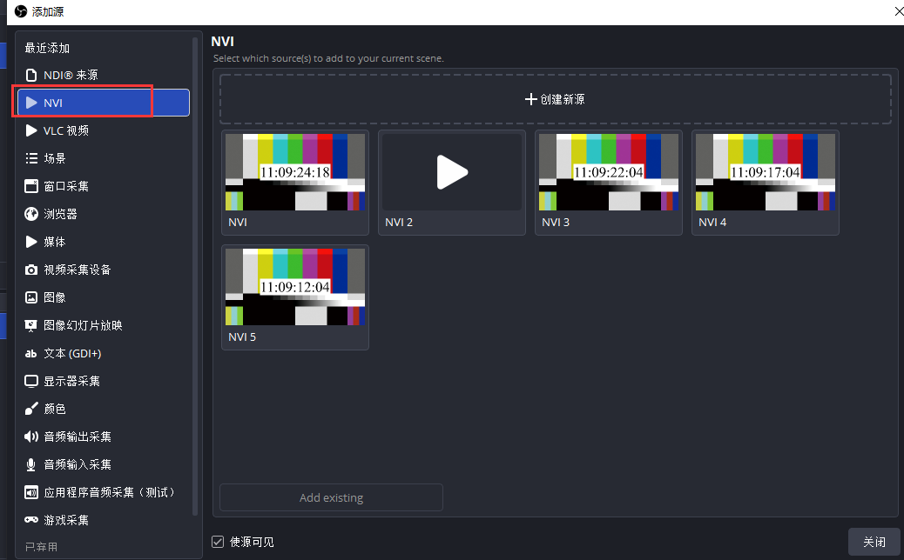
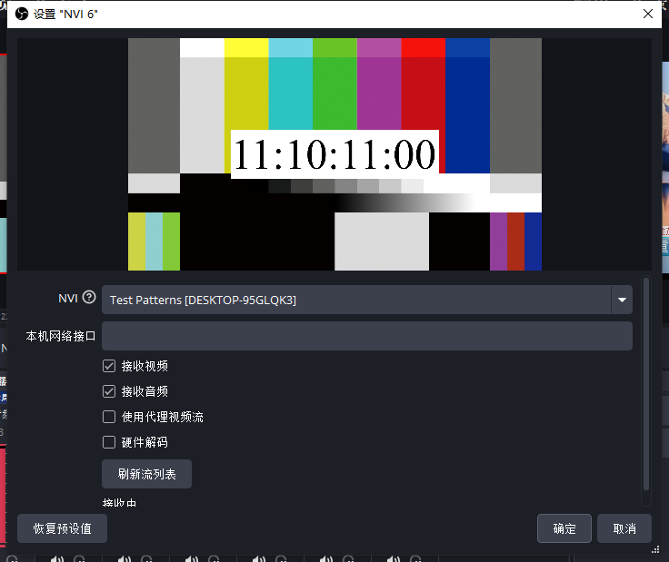
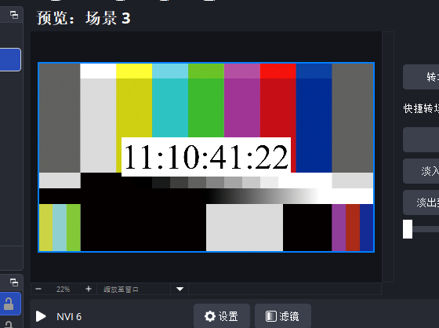
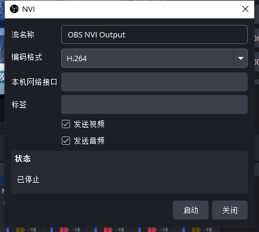
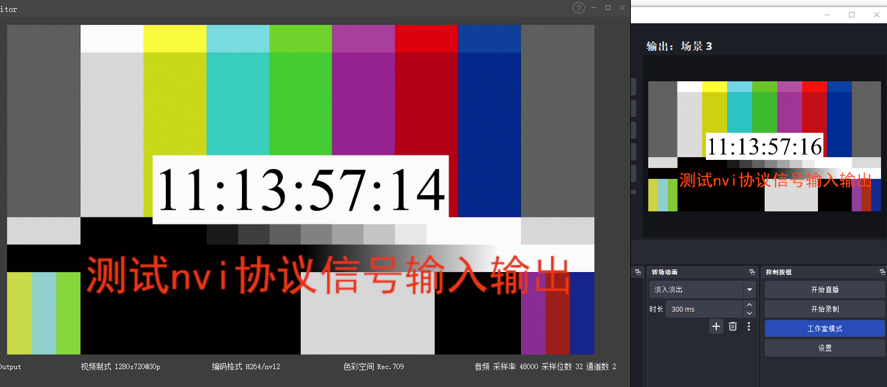

# obs-nvi

OBS Studio 的 **NVI（Network Video Interface）输入 / 输出插件**（Windows）。

*An OBS Studio plugin that adds NVI (Network Video Interface) input / output on Windows.*

基于 NVI 官方 SDK，把 OBS 接到 NVI 网络视频体系里：既可以把网络中的 NVI 流接收成 OBS 来源，
也可以把 OBS 的画面与声音编码后作为一路 NVI 流发送出去。

> 仅支持 **Windows x64**：NVI 官方 SDK 只提供 Windows 版本（`NVI.lib` + `NVI.dll`）。

---

## 下载 / Mirrors

| 站点 | 地址 | 说明 |
| --- | --- | --- |
| **Gitee**（主仓库） | <https://gitee.com/pjdx123/obs-nvi> | 主仓库，Issue / PR 请优先提交到这里 |
| **GitHub**（镜像） | <https://github.com/pjdx123/obs-nvi> | 由 Gitee 同步的镜像，内容与主仓库一致 |

```bash
git clone https://gitee.com/pjdx123/obs-nvi.git
```

---

## English Overview

**obs-nvi** is a Windows plugin for [OBS Studio](https://obsproject.com/) that adds **NVI
(Network Video Interface)** input and output:

- **NVI Source (input)** — discover and receive NVI network streams into OBS, with optional
  video / audio, proxy stream and hardware decoding.
- **NVI Output** — encode OBS audio / video into an NVI stream (AVC / HEVC / HF / SUVC);
  usable as an OBS output type or from the *Tools → NVI Output Settings…* dialog.

Requirements: Windows 10/11 x64, OBS Studio 30+, Visual Studio 2022, CMake 3.28+, Qt6 Widgets.
The NVI SDK (headers, `NVI.lib`, runtime DLLs) is bundled in `sdk/`.
Build, install and usage instructions are in the Chinese sections below.

**Keywords**: OBS Studio plugin, OBS NVI plugin, NVI source, NVI output, Network Video
Interface, NVI protocol, Sobey NVI, NVI 插件, 视频信号输入输出, video over IP, broadcast,
live streaming, video streaming, Windows x64, C++, CMake, Qt6, GPL-3.0.

---

## 功能特性

**NVI 源（输入）**

- 自动发现网络中的 NVI 流，下拉选择或直接填 URI
- 可选接收视频 / 音频、可选代理码流
- 可选硬件解码（`NVIRecvVideoAccelPreset`，解码结果仍回到主机内存）
- 属性页实时显示连接状态（未选择 / 库不可用 / 连接失败 / 接收中 / 已断开）

**NVI 输出**

- 把 OBS 的音频视频编码成 NVI 流发送
- 编码格式可选 H.264/AVC、H.265/HEVC、HF（高保真）、SUVC（可伸缩）
- 可设置流名称（alias）、标签、本机网络接口、是否发送视频 / 音频
- 既可作为 OBS 的输出类型，也可通过「工具 → NVI 输出设置…」独立启停

---

## 界面截图

**1. 添加 NVI 源**（来源面板 → `+` → NVI 源）



**2. 选择并配置 NVI 流**（属性页：流列表、本机接口、音视频 / 代理 / 硬解开关）



**3. 接收画面**（NVI 信号在 OBS 预览窗口显示）



**4. NVI 输出设置**（设置 → 输出，编码格式与发送项）



**5. 输出成功**（接收端 monitor 已收到该路 NVI 流）



---

## 目录结构

```
obs-nvi/
├── CMakeLists.txt            # 构建定义（目标 obs-nvi，支持独立构建 / 树内构建）
├── README.md                 # 本文档
├── LICENSE                   # GPL-3.0
├── data/
│   └── locale/               # 界面文案
│       ├── en-US.ini
│       └── zh-CN.ini
├── docs/
│   └── images/               # README 截图
├── sdk/                      # NVI 官方 SDK（随仓库提供）
│   ├── include/NVI/          # API 头文件，入口 <NVI/API.h>
│   ├── lib/NVI.lib           # 导入库
│   ├── runtime/              # 运行时：NVI.dll 与编解码插件
│   │   ├── NVI.dll
│   │   ├── FFmpegCodecPlugin.dll
│   │   ├── HFCodecPlugin.dll
│   │   ├── HFMCodecPlugin.dll
│   │   └── VXHFMDecoder.dll
│   ├── cmake/                # 官方 SDK 的 CMake 包（NVIConfig.cmake 等）
│   └── example/              # 官方示例代码（不参与构建）
└── src/
    ├── plugin-main.cpp       # 模块入口：注册源 / 输出、工具菜单、生命周期
    ├── nvi-plugin.h          # 插件级声明：版本、NVI_LOG 宏、注册入口
    ├── nvi-context.cpp/.h    # 进程级 NVI 上下文（引用计数单例）+ 运行时探测
    ├── nvi-common.cpp/.h     # 网络发现与像素格式 / 色彩空间 / 时间戳转换
    ├── nvi-source.cpp/.h     # NVI 源（obs_source_info）
    ├── nvi-output.cpp/.h     # NVI 输出（obs_output_info）+ 启停 / 状态查询
    └── nvi-output-ui.cpp     # 「工具」菜单里的 NVI 输出对话框（Qt）
```

---

## 环境要求

| 项目 | 要求 |
| --- | --- |
| 操作系统 | Windows 10 / 11 x64 |
| 编译器 | Visual Studio 2022（MSVC，含 Windows SDK 10.0.20348+） |
| CMake | ≥ 3.28 |
| Qt6 | `Widgets`（设置对话框需要） |
| OBS Studio | 30+，**独立构建时需要其开发文件**（`libobsConfig.cmake` / `obs-frontend-apiConfig.cmake`） |
| NVI SDK | 已随本仓库提供于 `sdk/`，无需另行下载 |

---

## 编译

### 方式 A：独立构建（推荐）

用已安装的 OBS 的开发文件构建，不需要 obs-studio 源码树。

```powershell
# 1) 配置（OBS_INSTALL_DIR 指向 OBS 安装目录）
cmake -S . -B build -G "Visual Studio 17 2022" -A x64 -DOBS_INSTALL_DIR="C:/Program Files/obs-studio"

# 2) 构建
cmake --build build --config Release
```

构建完成后会得到一个可直接合并进 OBS 的 **rundir**：

```
build/rundir/
├── bin/64bit/                    # NVI.dll 与编解码插件
│   ├── NVI.dll
│   ├── FFmpegCodecPlugin.dll
│   ├── HFCodecPlugin.dll
│   ├── HFMCodecPlugin.dll
│   └── VXHFMDecoder.dll
├── obs-plugins/64bit/
│   └── obs-nvi.dll               # 插件本体
└── data/obs-plugins/obs-nvi/
    └── locale/                   # en-US.ini / zh-CN.ini
```

> 如果 CMake 找不到 OBS 的开发文件，改用 `-DCMAKE_PREFIX_PATH="<OBS 安装目录>"`，
> 或确认 OBS 安装目录下存在 `lib/cmake/libobs/` 与 `lib/cmake/obs-frontend-api/`。

### 方式 B：树内构建

把本目录放进 obs-studio 源码树的 `plugins/nvi`，并在 `plugins/CMakeLists.txt` 中注册：

```cmake
add_obs_plugin(nvi PLATFORMS WINDOWS WITH_MESSAGE)
```

随后按 obs-studio 的正常流程构建即可：

```powershell
cmake --build build64 --config RelWithDebInfo --target obs-nvi
```

### 构建选项

| 选项 / 变量 | 默认值 | 说明 |
| --- | --- | --- |
| `ENABLE_NVI` | `ON` | 是否构建本插件；关闭后直接跳过 |
| `OBS_INSTALL_DIR` | 空 | OBS 安装目录，用于独立构建时定位开发文件 |
| `NVI_RUNTIME_DIR` | `sdk/runtime` | NVI 运行时 DLL 目录；构建后会被拷到 `bin/64bit` |

关闭插件：`cmake -S . -B build -DENABLE_NVI=OFF`

---

## 安装 / 集成到 OBS

### 方式 1：合并 rundir（推荐，无需管理员权限）

先**完全退出** OBS，然后把 `build/rundir` 下的三个目录合并进 OBS 安装目录（同名目录直接覆盖/合并）：

| 来源（build/rundir 下） | 目标（OBS 安装目录下） |
| --- | --- |
| `bin/64bit/*.dll` | `bin/64bit/` |
| `obs-plugins/64bit/obs-nvi.dll` | `obs-plugins/64bit/` |
| `data/obs-plugins/obs-nvi/` | `data/obs-plugins/obs-nvi/` |

即必须保证下面三处都存在：

```
<OBS>/bin/64bit/NVI.dll                     ← 运行时，必须与 obs64.exe 同目录
<OBS>/obs-plugins/64bit/obs-nvi.dll         ← 插件本体
<OBS>/data/obs-plugins/obs-nvi/locale/      ← 本地化文案
```

### 方式 2：直接安装

```powershell
cmake --install build --prefix "C:/Program Files/obs-studio"
```

（若安装到 Program Files 需要以管理员身份运行。）

### 方式 3：树内构建后

树内构建时，产物会自动落到 obs-studio 的 `rundir`，`<OBS>/bin/64bit` 的运行时 DLL 也会自动拷贝，
无需手工搬运。

### 验证是否加载成功

打开 OBS，在 **帮助 → 日志文件 → 查看当前日志** 中搜索 `[nvi]`，应能看到：

```
[nvi] NVI library '<版本>' initialized
[nvi] NVI context held for the plugin lifetime
[nvi] plugin loaded (version 0.1.0)
```

---

## 使用说明

### 1. NVI 源（接收）

1. 在「来源」面板点 `+`，选择 **NVI 源**。
2. 在属性页配置：

| 属性 | 说明 |
| --- | --- |
| **NVI 流** | 从发现的流列表中选择（显示名形如 `别名 [站点]`），或直接填写 URI |
| **本机网络接口** | 留空表示使用默认接口 |
| **接收视频** / **接收音频** | 是否接收对应数据 |
| **使用代理视频流** | 接收代理码流（低分辨率预览用） |
| **硬件解码** | 使用硬件解码，解码结果仍回到主机内存 |
| **刷新流列表** | 重新扫描网络中的 NVI 流 |

3. 属性页底部会显示当前状态：未选择 NVI 流 / NVI 库不可用 / 连接失败 / 接收中 / 连接已断开。

> 首次打开属性页若列表为空，请稍候再点一次「刷新流列表」：NVI 的流发现结果是在上下文内
> **异步累积**的，需要上下文存活一小段时间后才可见。

### 2. NVI 输出（发送）

在 **设置 → 输出** 中把输出类型选为 **NVI 输出**，或在来源的输出场景中选择它：

| 设置项 | 说明 |
| --- | --- |
| 流名称（`nvi_alias`） | 对外发布的流别名 |
| 编码格式（`nvi_codec`） | H.264/AVC、H.265/HEVC、HF（高保真）、SUVC（可伸缩） |
| 本机网络接口（`nvi_out_local`） | 留空表示默认接口 |
| 标签（`nvi_tags`） | 逗号分隔的标签 |
| 发送视频 / 发送音频 | 发送哪些数据；都不选时会提示「没有可用的音频或视频数据」 |

### 3. 工具菜单 · NVI 输出设置…

有 GUI 前端时，插件会在 **工具** 菜单加入 **NVI 输出设置…**：

- 参数会以 JSON 保存在 OBS 模块配置目录的 `output.json`，下次打开自动恢复；
- 提供 **启动 / 停止** 与状态显示（已停止 / 运行中（N 个接收端）/ 错误）；
- 该输出由对话框独立创建与持有，与「设置 → 输出」里的输出互不影响。

---

## 实现要点

**为什么目标名是 `obs-nvi` 而不是 `nvi`？**

1. Windows 文件名大小写不敏感，`nvi.dll` 会与 NVI 运行时的 `NVI.dll` 同名，二者放在
   `obs-plugins/64bit` 会互相覆盖；
2. OBS 按 DLL 文件名推导模块数据目录（`data/obs-plugins/%module%`），只有 target 名与文件名
   一致，`data/` 才会被装到 `obs-plugins/obs-nvi`，本地化 `locale` 才能被找到。

**NVI.dll 用延迟加载（`/DELAYLOAD`）**

只有在真正调用 NVI API 时才需要 `NVI.dll`。这样即使目标机器缺少运行时，插件本身仍能正常
加载，只是源 / 输出提示「NVI 库不可用」。

**NVI 上下文全程常驻**

NVI 的网络发现结果在上下文内部异步累积：上下文刚创建时枚举会返回空。因此模块加载时用
`nvi_context_hold()` 长期持有上下文，卸载时再释放，避免「刷新不出信号源」的问题。

**退出前先停输出**

收到 `OBS_FRONTEND_EVENT_EXIT` 时立即停止由本插件启动的 NVI 输出，保证发送线程先于模块
卸载结束。

---

## 常见问题

| 现象 | 排查方向 |
| --- | --- |
| 源属性页提示 **NVI 库不可用** | `NVI.dll` 不在 `bin/64bit`（必须与 `obs64.exe` 同目录）；确认运行时 DLL 已按上表放置，或检查 `NVI_RUNTIME_DIR` |
| 来源 / 输出列表里找不到 NVI | 插件未加载。日志中应有 `[nvi] plugin loaded`；否则检查 `obs-nvi.dll` 是否在 `obs-plugins/64bit` |
| 流列表始终为空 | 上下文未能常驻（见「实现要点」）；或刷新后稍等片刻再试 |
| 画面全黑 | NVI 色彩空间未正确映射到 OBS 的 `video_colorspace` / `video_trc`，导致 YUV→RGB 矩阵为 0 |
| 界面仍是英文 | `data/obs-plugins/obs-nvi/locale` 未安装到位（依赖目标名与文件名均为 `obs-nvi`） |
| 独立构建找不到 OBS | 用 `-DOBS_INSTALL_DIR="<OBS 安装目录>"` 或 `-DCMAKE_PREFIX_PATH=<OBS 安装目录>` |

所有插件日志都带 `[nvi]` 前缀，可在 OBS 日志中直接搜索 `[nvi]` 过滤。

---

## 许可证

- 本插件（`src/`、`data/`、`CMakeLists.txt` 等）：**GPL-3.0**，详见 [LICENSE](LICENSE)。
  OBS Studio / libobs 采用 “GPL-2.0 或更高版本”，两者兼容。
- NVI SDK（`sdk/` 下的头文件、`NVI.lib`、`NVI.dll` 及编解码插件）：版权归 **Sobey Digital Inc.**
  所有，随官方 SDK 分发，使用时请遵守其许可条款。
